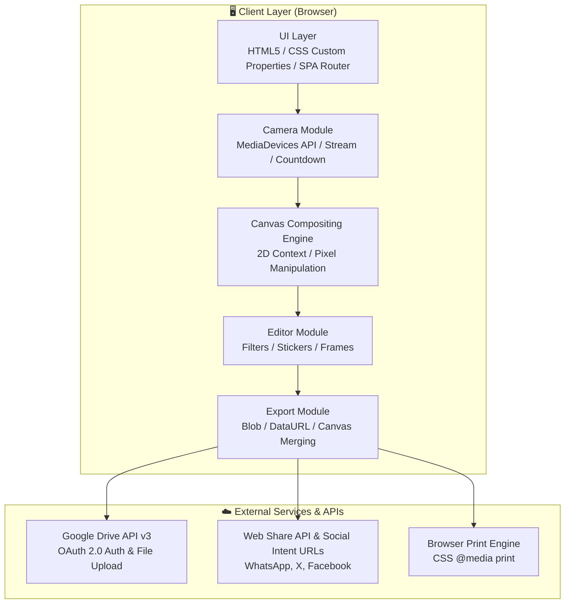
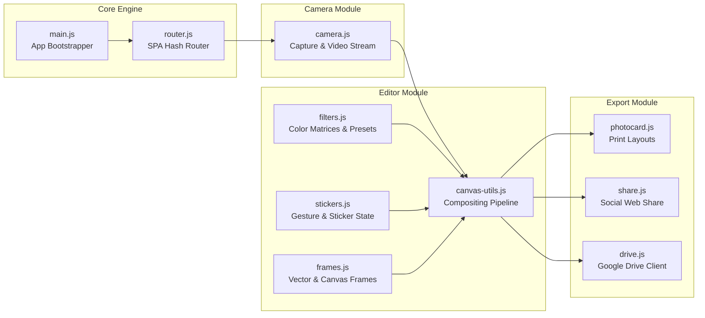
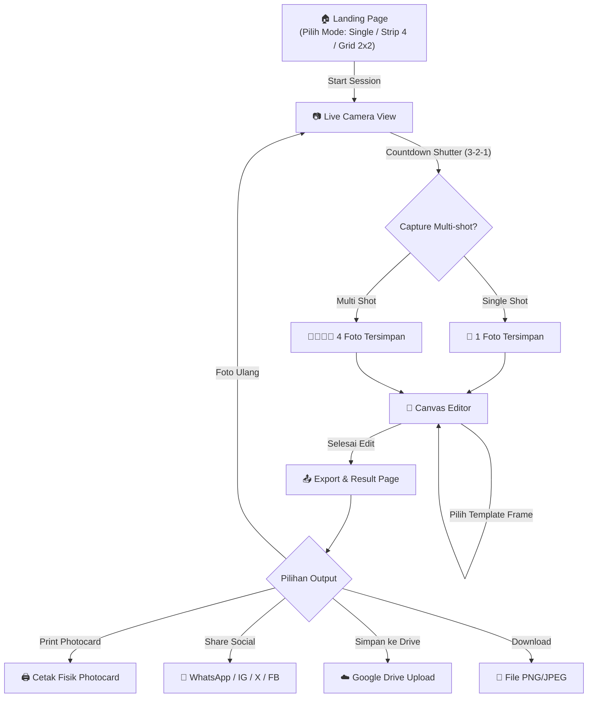

# 📸 Photo Studio — Master Architecture & Roadmap

> **Konsep**: Minimalist Photobooth Web Application  
> **Repository**: [https://github.com/ardhitosaputra/photo-studio-project](https://github.com/ardhitosaputra/photo-studio-project)  
> **Tech Stack**: Vite + Vanilla JS + Canvas 2D API  
> **Target**: Modern browsers (Desktop & Mobile) dengan dukungan Web Camera & Touch Gestures  

---

## 1. Product Vision & Value Proposition

Photo Studio adalah aplikasi photobooth berbasis web berkonsep **minimalis, elegan, dan intuitif**. Pengguna dapat:
1. Mengambil foto secara real-time via kamera browser (single atau multi-shot).
2. Mengaplikasikan filter artistik (grayscale, sepia, vintage, cool, warm, noir, dsb).
3. Menambahkan stiker dekoratif yang dapat digeser (drag & drop), diputar (rotate), dan diatur ukurannya (scale).
4. Menambahkan frame/bingkai estetik (Polaroid, Vintage, Neon, Minimal, 35mm Film Strip, Gradient).
5. Menghasilkan dan mencetak photocard (strip 4 foto, 2×2 grid, single polaroid) dengan format print-ready.
6. Membagikan hasil foto langsung ke media sosial (WhatsApp, Instagram, Twitter/X, Facebook) melalui Web Share API.
7. Menyimpan foto langsung ke Google Drive menggunakan Google Drive API v3.

---

## 2. Core Feature Matrix

| ID | Fitur | Status | Deskripsi |
|---|---|:---:|---|
| **F1** | **Camera & Multi-Capture** | 🟡 In Progress | Akses kamera perangkat, hitung mundur (countdown 3-2-1), flash shutter, flip camera, multi-shot strip (4 shot) & single shot. |
| **F2** | **Filter Presets** | 🟡 In Progress | Manipulasi piksel & shader CSS/Canvas (B&W, Vintage, Sepia, Warm, Cool, Noir, Pastel, Retro, dsb) secara real-time. |
| **F3** | **Interactive Stickers** | 🟡 In Progress | Stiker emoji, props, dan ornamen dekoratif dengan interaksi drag, resize, rotate, dan delete. |
| **F4** | **Aesthetic Frames** | 🟡 In Progress | Template bingkai foto (Polaroid dengan area memo, Vintage film, Neon glow border, Minimalist clean, Film strip 35mm). |
| **F5** | **Photocard Print** | 🟡 In Progress | Generator layout photocard siap cetak (Strip 4 foto vertikal, Grid 2×2, Single) terintegrasi `@media print`. |
| **F6** | **Social Media Share** | 🟡 In Progress | Native Web Share API (mobile) + direct link fallback (WhatsApp, Twitter/X, Facebook, copy link). |
| **F7** | **Google Drive Sync** | 🟡 In Progress | Upload hasil foto ke Google Drive melalui OAuth 2.0 Client-side / REST API v3. |

---

## 3. System Architecture

### 3.1 High-Level Architecture Diagram



### 3.2 Modular Component Breakdown



---

## 4. User Flow & State Progression



---

## 5. Project Directory Structure

```
photo-studio-project/
├── index.html                    # Root HTML document
├── package.json                  # Dependencies & scripts
├── README.md                     # Project documentation
├── issue.md                      # Master Architecture & Roadmap
│
├── public/
│   ├── favicon.svg               # App icon
│   └── icons.svg                 # SVG sprite sheet
│
└── src/
    ├── main.js                   # Application bootstrap
    ├── router.js                 # SPA hash router
    │
    ├── pages/
    │   ├── home.js               # Landing page & mode selection
    │   ├── camera.js             # Live camera capture & countdown
    │   ├── editor.js             # Filter, sticker, and frame editor
    │   └── export.js             # Sharing, printing, and cloud save
    │
    ├── styles/
    │   ├── index.css             # Design tokens & CSS reset
    │   ├── components.css        # Buttons, cards, modals, toast
    │   ├── animations.css        # Keyframes & micro-interactions
    │   ├── home.css              # Landing page styling
    │   ├── camera.css            # Viewport & shutter UI
    │   ├── editor.css            # Editor toolbars & sticker controls
    │   ├── export.css            # Layout cards & share modal
    │   └── print.css             # Dedicated @media print layout
    │
    ├── components/
    │   ├── modal.js              # Reusable accessible modal dialog
    │   └── toast.js              # Non-intrusive notification toasts
    │
    └── utils/
        ├── canvas-utils.js       # Canvas 2D render & compositing helpers
        ├── constants.js          # Presets, modes, frames, stickers config
        ├── dom.js                # DOM utility functions
        ├── icons.js              # Lucide-style SVG icon system
        └── storage.js            # Safe localStorage wrapper
```

---

## 6. Technical Specifications & Integrations

### 6.1 Google Drive Integration (F7)
- **API**: Google Drive REST API v3 (`files.create`)
- **Auth Flow**: Google Identity Services (GIS) Token Client (Client-Side OAuth 2.0).
- **Scope**: `https://www.googleapis.com/auth/drive.file` (hanya mengakses file yang dibuat oleh aplikasi ini).
- **Payload**: `multipart/related` request memuat metadata (nama file, mimeType `image/png`) dan binary stream foto.

### 6.2 Web Share API & Social Fallbacks (F6)
- **Mobile First**: `navigator.share({ files: [blobFile], title: 'My Photobooth Shot', text: '#PhotoStudio' })`
- **Fallback Desktop**:
  - WhatsApp: `https://api.whatsapp.com/send?text={encodedMessage}`
  - Twitter / X: `https://twitter.com/intent/tweet?text={encodedMessage}&url={url}`
  - Facebook: `https://www.facebook.com/sharer/sharer.php?u={url}`
  - Copy Direct Image / Link to clipboard via Clipboard API.

### 6.3 Canvas 2D Engine & Compositing (F2, F3, F4, F5)
- **Base Layer**: Tangkapan kamera (Aspect ratio 4:3 atau 1:1) disesuaikan resolusi tinggi (1280x960+).
- **Filter Layer**: Dilakukan melalui Canvas `ctx.filter` dan konvolusi pixel manipulation untuk efek klasik/noir.
- **Sticker Layer**: Objek stiker interaktif dengan koordinat `(x, y)`, `scale`, dan `rotation` yang digambar di atas layer foto.
- **Frame Layer**: Gambar bingkai tematik dirender di layer teratas untuk presisi framing.
- **Layout Generator**: Menyatukan 4 foto berurutan menjadi Photo Strip vertikal atau Grid 2×2 dengan border photocard autentik.

---

## 7. Development Roadmap & Milestones

### Phase 1: Foundation & Camera Core (Target: Week 1 - 2)
- [x] Project initialization dengan Vite & Vanilla JavaScript
- [x] Repository setup di GitHub: `https://github.com/ardhitosaputra/photo-studio-project.git`
- [x] Desain sistem lengkap: CSS variables, Dark Mode, glassmorphism, tipografi Space Grotesk & Inter
- [x] SPA Hash-based Router dengan page transition animations
- [x] Landing Page dengan pilihan mode (Single, Photo Strip, 2×2 Grid)
- [x] Modul Kamera (live stream, mirror flip, countdown timer 3-2-1, shutter flash, upload fallback)
- [x] Master Architecture & Roadmap document di `issue.md`

### Phase 2: Canvas Editor — Filter, Stiker & Frame (Target: Week 3 - 4)
- [ ] Canvas Editor view dengan live composite preview
- [ ] 12 Preset Filter (Original, B&W, Sepia, Vintage, Warm, Cool, Dramatic, Fade, Noir, Vivid, Pastel, Retro)
- [ ] Sticker Drawer (Kategori Emoji, Props, Badges, Decorative)
- [ ] Sticker manipulation (Drag & drop, pinch/wheel resize, touch gestures, delete)
- [ ] Frame Overlay Drawer (Polaroid, Vintage, Neon, Minimalist, 35mm Film Strip, Gradient)
- [ ] Canvas rendering & merging ke format final Blob/DataURL

### Phase 3: Export, Photocard Print & Sharing (Target: Week 5 - 6)
- [ ] Export Result view dengan perbandingan layout
- [ ] Layout Photocard:
  - [ ] Single Polaroid photocard dengan label memo
  - [ ] Vertical 4-cut Photo Strip photocard
  - [ ] 2×2 Grid Photocard
- [ ] Fitur Print Photocard dengan optimasi format `@media print`
- [ ] Download lokal (PNG / JPEG) resolusi tinggi
- [ ] Integrasi Web Share API untuk native mobile sharing
- [ ] Fallback modal share ke WhatsApp, Instagram, X, Facebook
- [ ] Setup integrasi Google Identity Services & Google Drive API v3

### Phase 4: Polish, Testing & Deployment (Target: Week 7 - 8)
- [ ] Sound effects (Shutter click sound, countdown beep)
- [ ] Optimasi responsivitas mobile & touch interactions
- [ ] PWA (Progressive Web App) manifest & service worker untuk offline capability
- [ ] Audit performa (Lighthouse score > 90)
- [ ] Deploy ke GitHub Pages / Vercel
- [ ] End-to-end user testing & documentation update

---

## 8. Risk Management & Mitigations

| Risiko | Dampak | Strategi Mitigasi |
|---|:---:|---|
| Pengguna menolak izin akses kamera | Tinggi | Menyediakan alternatif upload foto dari galeri/penyimpanan lokal |
| File gambar hasil render terlalu besar untuk share/print | Sedang | Optimasi resolusi canvas dan kompresi kualitas gambar JPEG/PNG |
| Browser desktop tidak mendukung Web Share API files | Sedang | Menyediakan opsi download instan dan direct link share |
| Kuota / OAuth consent Google Drive API | Sedang | Menggunakan flow client-side token yang ringkas tanpa kebutuhan server backend |
